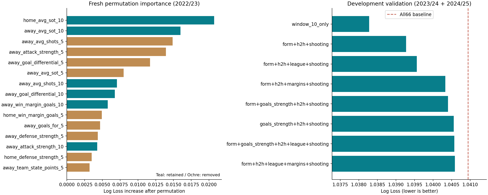
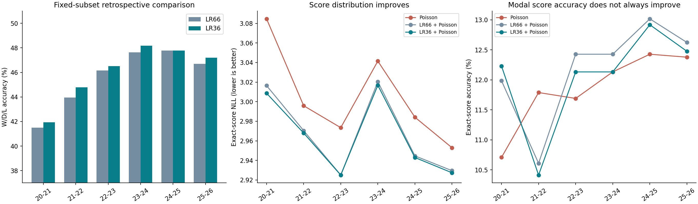

# 从原始 66 特征重新筛选，再验证泛化与泊松融合

实验日期：2026-10-15。全部训练、重要性排序、候选搜索和逐场预测均在本次本地重新执行。

## 先回答研究问题

1. **重新筛选得到什么？** 从 66 列出发，在 76 个候选组合中，以历史验证 Log Loss 为主指标，筛选得到 `window_10_only`：36 列。
2. **简化 LR 是否优于原版？** 六季总体准确率 45.629% → 46.071%，净多正确 54 场；LL 1.056095 → 1.053133，Brier 也降低。主指标改善，因此继续检验融合。但 Macro F1、平局 F1 下降，不能称为所有指标全面更好。
3. **能否认为准确率稳定提升？** 日期聚类区间下，六季准确率差的 95% CI 包含零；六季 LL 差的区间不包含零。按六个赛季重抽的敏感性区间另列，不能挑更乐观的区间下结论。
4. **简化 LR 指导泊松后是否改善？** 相比纯泊松，赛果 LL、比分 NLL、主客及总进球 MAE 均改善；精确比分命中率点估计提高，但区间包含零。
5. **是否超过原版 LR＋泊松？** 比分 NLL 进一步降低，但精确比分命中率下降，主客及总进球 MAE 也略变差，相关差异区间包含零。因此只支持概率评分进一步改善，不支持所有比分指标进一步改善。

## 1. 实验流程与筛选方法

原始 66 特征 LR → 重新做重要性与候选组合验证 → 冻结新胜出的列集 → 固定列集六季 walk-forward 对照 → 在主指标改善后分析泊松融合。

- 原版和简化版均为训练集均值插补、未标准化 LogisticRegression，C=1、lbfgs、max_iter=4000、种子42。只改变输入列，避免把标准化或调参收益归于特征删减。
- 排序：用 2019/20–2021/22 拟合，在 2022/23 做五次按联赛分块的置换重要性；组合验证：分别用此前全部赛季训练，验证 2023/24 和 2024/25。按合并验证 Log Loss 选定，2025/26 不参与候选排序或选择。
- 候选包括特征族组合、重要性前若干列、去掉尾部若干列、正置换重要性列、仅近5场/仅近10场、相关性删减。重要性用于提出候选，最终以组合验证判断；不是简单把最末30列删除。
- 泊松：复用原始 LoukasPoissonModel.fit 与 smoothing=0.05；三种比分模型共用由赛前 λ 决定的自适应网格，联合尾部遗漏≤1e-12。
- 融合：三个赛果区域分别重加权，F(i,j)=q_LR(c)×P(i,j)/P(c)，alpha=1；没有根据测试比分调节融合强度。
- 整个筛选和训练流程从原始 CSV 重新执行，没有使用旧逐场 LR 概率替代本次训练。

## 2. 为什么选中这个简化组合

| 候选组合 | 列数 | 验证准确率 | 验证 Log Loss |
|---|---|---|---|
| window_10_only | 36 | 47.986% | 1.03828 |
| groups__form__h2h__shooting | 37 | 47.741% | 1.03927 |
| groups__form__h2h__league__shooting | 38 | 47.814% | 1.03956 |
| groups__form__h2h__margins__shooting | 45 | 47.839% | 1.04033 |
| groups__form__goals_strength__h2h__shooting | 57 | 47.642% | 1.04040 |
| groups__goals_strength__h2h__shooting | 41 | 47.544% | 1.04056 |
| groups__form__goals_strength__h2h__league__shooting | 58 | 47.692% | 1.04057 |
| groups__form__h2h__league__margins__shooting | 46 | 47.692% | 1.04059 |
| groups__form__goals_strength__h2h__margins__shooting | 65 | 47.692% | 1.04063 |
| groups__goals_strength__h2h__league__shooting | 42 | 47.520% | 1.04065 |

完整 66 列验证基线：

| 组合 | 列数 | 验证准确率 | 验证 Log Loss |
|---|---|---|---|
| all_66 | 66 | 47.716% | 1.04094 |

选择后保留 36 列，删除 30 列，输入数量减少 45.45%。该组合是所搜索候选中验证 LL 最低的方案；不意味着它是所有可能列集中的全局最优，也不是特征数量最少的方案。

新排序前15列：

| 排序 | 特征 | 置换后 LL 增量均值 | 重复标准差 |
|---|---|---|---|
| 1 | home_avg_sot_10 | 0.02073 | 0.00434 |
| 2 | away_avg_sot_10 | 0.01598 | 0.00263 |
| 3 | away_avg_shots_5 | 0.01488 | 0.00096 |
| 4 | away_attack_strength_5 | 0.01395 | 0.00208 |
| 5 | away_goal_differential_5 | 0.01171 | 0.00163 |
| 6 | away_avg_sot_5 | 0.00800 | 0.00230 |
| 7 | away_avg_shots_10 | 0.00705 | 0.00053 |
| 8 | away_goal_differential_10 | 0.00676 | 0.00255 |
| 9 | away_win_margin_goals_10 | 0.00574 | 0.00126 |
| 10 | home_win_margin_goals_5 | 0.00492 | 0.00182 |
| 11 | away_goals_for_5 | 0.00467 | 0.00158 |
| 12 | away_defense_strength_5 | 0.00435 | 0.00187 |
| 13 | away_attack_strength_10 | 0.00427 | 0.00166 |
| 14 | home_defense_strength_5 | 0.00348 | 0.00059 |
| 15 | away_team_state_points_5 | 0.00319 | 0.00098 |

仅在排序季之前的历史中，绝对相关系数≥0.95 的特征对有 12 对，详见 high_correlation_pairs.csv。相关性说明存在重叠信息，但并不能单独证明应该删哪一列。即使部分5场特征重要性较高，仍可能因与其他输入重叠而在组合删减时改善泛化。

新组合保留全部近10场主客统计，以及5个交锋指标和联赛级别，删除近5场窗口。完整列清单见文末。



## 3. 赛季归属与 walk-forward 边界

**赛季以原始 E0–E3 CSV 文件名为准，绝不按八月或其他月份切分。** 独立逐行匹配源文件、比赛日期、球队、比分、标签和赛季。28份文件共13,988场，测试12,216场；初始2019/20共1,772场仅作训练历史。

- 35场2022年7月比赛按 E12223/E22223/E32223 文件归到2022/23。
- 疫情延迟至2020年7月的2019/20比赛，仍保留在2019/20。完整逐文件日期范围及七月场次见 source_file_audit.csv。
- 每折用此前所有完整赛季训练；测试季模型参数冻结。近期特征可使用此前日期的已完赛比赛，不使用当场、同日或未来赛果。

| 测试季 | 训练赛季 | 训练场次 | 测试场次 | 训练最后日期 | 测试首日 |
|---|---|---|---|---|---|
| 2020-21 | 2019-20 | 1772 | 2036 | 2020-07-26 | 2020-09-11 |
| 2021-22 | 2019-20,2020-21 | 3808 | 2036 | 2021-05-23 | 2021-08-06 |
| 2022-23 | 2019-20,2020-21,2021-22 | 5844 | 2036 | 2022-05-22 | 2022-07-29 |
| 2023-24 | 2019-20,2020-21,2021-22,2022-23 | 7880 | 2036 | 2023-05-28 | 2023-08-04 |
| 2024-25 | 2019-20,2020-21,2021-22,2022-23,2023-24 | 9916 | 2036 | 2024-05-19 | 2024-08-09 |
| 2025-26 | 2019-20,2020-21,2021-22,2022-23,2023-24,2024-25 | 11952 | 2036 | 2025-05-25 | 2025-08-01 |

## 4. 原版 LR 与简化 LR：先检验特征工程

| 模型 | 场次 | 正确场次 | 准确率 | Log Loss | Brier | Macro F1 | 平局 F1 |
|---|---|---|---|---|---|---|---|
| 原版 LR（66） | 12216 | 5574 | 45.629% | 1.05610 | 0.21198 | 0.35229 | 0.04207 |
| 简化 LR（36） | 12216 | 5628 | 46.071% | 1.05313 | 0.21141 | 0.34928 | 0.02659 |

逐季：

| 范围 | 场次 | 66 准确率 | 36 准确率 | 净多正确 | 66 LL | 36 LL | LL 差值 |
|---|---|---|---|---|---|---|---|
| 2020-21 | 2036 | 41.503% | 41.945% | 9 | 1.09252 | 1.08472 | -0.00780 |
| 2021-22 | 2036 | 43.959% | 44.794% | 17 | 1.06323 | 1.06079 | -0.00245 |
| 2022-23 | 2036 | 46.169% | 46.513% | 7 | 1.04701 | 1.04695 | -0.00007 |
| 2023-24 | 2036 | 47.642% | 48.183% | 11 | 1.03720 | 1.03355 | -0.00365 |
| 2024-25 | 2036 | 47.790% | 47.790% | 0 | 1.04469 | 1.04301 | -0.00168 |
| 2025-26 | 2036 | 46.709% | 47.200% | 10 | 1.05192 | 1.04979 | -0.00213 |

逐联赛（E0英超、E1英冠、E2英甲、E3英乙）：

| 范围 | 场次 | 66 准确率 | 36 准确率 | 净多正确 | 66 LL | 36 LL | LL 差值 |
|---|---|---|---|---|---|---|---|
| E0 | 2280 | 51.316% | 51.667% | 8 | 1.01111 | 1.00792 | -0.00319 |
| E1 | 3312 | 42.633% | 43.297% | 22 | 1.07218 | 1.06902 | -0.00316 |
| E2 | 3312 | 46.649% | 47.343% | 23 | 1.05199 | 1.05015 | -0.00184 |
| E3 | 3312 | 43.690% | 43.720% | 1 | 1.07508 | 1.07136 | -0.00372 |

六季中准确率提高 5/6、持平 1/6；LL改善 6/6。四联赛 LL 改善 4/4；24个季×联赛单元 LL 改善 18/24。分组结果为描述性分析，没有进行多重比较校正。

模型输入与保存体积：

| 模型 | 输入列数 | 系数及截距个数 | 平均模型字节 | 平均拟合秒 | 平均预测秒 |
|---|---|---|---|---|---|
| lr66 | 66 | 201 | 3421.83333 | 1.95131 | 0.00340 |
| lr_selected | 36 | 111 | 2326.00000 | 0.60760 | 0.00231 |

输入列数与参数数量的减少是确定的。时间仅为本机单次执行的描述，不是多轮性能基准；本实验先构建全部66列再取子集，没有测量精简特征生成后的端到端加速。

## 5. 在此基础上检验泊松融合

| 模型 | 胜平负准确率 | 胜平负 LL | 精确比分命中率 | 比分 NLL | 主球 MAE | 客球 MAE | 总球 MAE |
|---|---|---|---|---|---|---|---|
| 纯泊松 | 42.019% | 1.09379 | 11.853% | 3.00542 | 1.04658 | 0.94239 | 1.39461 |
| 66 特征 LR＋泊松 | 45.629% | 1.05610 | 12.181% | 2.96772 | 0.99905 | 0.92388 | 1.37539 |
| 36 特征 LR＋泊松 | 46.071% | 1.05313 | 12.050% | 2.96476 | 0.99938 | 0.92414 | 1.37545 |

MAE来自各自比分矩阵的期望进球，不沿用原泊松λ作为融合期望。精确比分命中率来自概率最高的比分；胜平负预测来自区域总概率。

逐季比分结果：

| 赛季 | 模型 | 精确比分命中率 | 比分 NLL | 主球 MAE | 客球 MAE | 总球 MAE |
|---|---|---|---|---|---|---|
| 2020-21 | 纯泊松 | 10.707% | 3.08466 | 1.14637 | 0.97686 | 1.52521 |
| 2020-21 | 66 特征 LR＋泊松 | 11.984% | 3.01641 | 1.05354 | 0.94312 | 1.47579 |
| 2020-21 | 36 特征 LR＋泊松 | 12.230% | 3.00861 | 1.05386 | 0.94318 | 1.47633 |
| 2021-22 | 纯泊松 | 11.788% | 2.99587 | 1.00164 | 0.94776 | 1.33967 |
| 2021-22 | 66 特征 LR＋泊松 | 10.609% | 2.97040 | 0.94750 | 0.95634 | 1.32797 |
| 2021-22 | 36 特征 LR＋泊松 | 10.413% | 2.96795 | 0.94922 | 0.95613 | 1.32804 |
| 2022-23 | 纯泊松 | 11.690% | 2.97344 | 1.03404 | 0.94666 | 1.40079 |
| 2022-23 | 66 特征 LR＋泊松 | 12.426% | 2.92505 | 0.98296 | 0.92701 | 1.38225 |
| 2022-23 | 36 特征 LR＋泊松 | 12.132% | 2.92498 | 0.98371 | 0.92814 | 1.38225 |
| 2023-24 | 纯泊松 | 12.132% | 3.04148 | 1.02710 | 0.94128 | 1.34002 |
| 2023-24 | 66 特征 LR＋泊松 | 12.426% | 3.02042 | 1.00429 | 0.92597 | 1.33352 |
| 2023-24 | 36 特征 LR＋泊松 | 12.132% | 3.01676 | 1.00388 | 0.92656 | 1.33285 |
| 2024-25 | 纯泊松 | 12.426% | 2.98411 | 1.05303 | 0.92771 | 1.40639 |
| 2024-25 | 66 特征 LR＋泊松 | 13.016% | 2.94460 | 1.02128 | 0.89878 | 1.39227 |
| 2024-25 | 36 特征 LR＋泊松 | 12.917% | 2.94292 | 1.02053 | 0.89884 | 1.39252 |
| 2025-26 | 纯泊松 | 12.377% | 2.95293 | 1.01728 | 0.91407 | 1.35558 |
| 2025-26 | 66 特征 LR＋泊松 | 12.623% | 2.92947 | 0.98477 | 0.89204 | 1.34057 |
| 2025-26 | 36 特征 LR＋泊松 | 12.475% | 2.92735 | 0.98511 | 0.89199 | 1.34070 |

逐联赛比分结果：

| 联赛 | 模型 | 精确比分命中率 | 比分 NLL | 主球 MAE | 客球 MAE | 总球 MAE |
|---|---|---|---|---|---|---|
| E0 | 纯泊松 | 11.096% | 3.12482 | 1.10207 | 1.00242 | 1.48586 |
| E0 | 66 特征 LR＋泊松 | 11.272% | 3.08272 | 1.04776 | 0.98563 | 1.45915 |
| E0 | 36 特征 LR＋泊松 | 11.053% | 3.07953 | 1.04841 | 0.98562 | 1.45862 |
| E1 | 纯泊松 | 12.349% | 2.98300 | 1.04438 | 0.92806 | 1.35634 |
| E1 | 66 特征 LR＋泊松 | 11.866% | 2.92788 | 0.98823 | 0.90425 | 1.33564 |
| E1 | 36 特征 LR＋泊松 | 11.896% | 2.92471 | 0.98783 | 0.90548 | 1.33602 |
| E2 | 纯泊松 | 11.322% | 3.00328 | 1.04848 | 0.94006 | 1.37271 |
| E2 | 66 特征 LR＋泊松 | 12.832% | 2.96268 | 0.99873 | 0.92104 | 1.35725 |
| E2 | 36 特征 LR＋泊松 | 12.258% | 2.96084 | 0.99941 | 0.92122 | 1.35726 |
| E3 | 纯泊松 | 12.409% | 2.94778 | 1.00867 | 0.91772 | 1.39197 |
| E3 | 66 特征 LR＋泊松 | 12.470% | 2.93345 | 0.97667 | 0.90384 | 1.37564 |
| E3 | 36 特征 LR＋泊松 | 12.681% | 2.92973 | 0.97716 | 0.90340 | 1.37581 |

**融合的赛果概率按定义等于输入LR概率。逐场比分NLL差也严格等于赛果LL差。** 因而比分NLL改善来自赛果区域质量分配，不能把它解释成又学会了区域内部比分结构；精确比分命中和进球MAE没有自动改善保证。



## 6. 配对差异和不确定性

差值均为“后者−前者”。准确率、比分命中率正值更好；LL/NLL、MAE负值更好。
主区间使用4,000次按赛季分层、完整比赛日期成组的配对bootstrap；另给出六个赛季成组的敏感性区间。六个赛季簇很少；两种方法均未涵盖特征选择及重新训练带来的全部不确定性。

| 比较 | 指标 | 差值 | 日期95%下限 | 日期95%上限 | 赛季95%下限 | 赛季95%上限 |
|---|---|---|---|---|---|---|
| lr_selected_minus_lr66 | accuracy | 0.00442 | -0.00016 | 0.00911 | 0.00237 | 0.00630 |
| lr_selected_minus_lr66 | log_loss | -0.00296 | -0.00457 | -0.00131 | -0.00520 | -0.00129 |
| fusion66_minus_poisson | accuracy | 0.03610 | 0.02713 | 0.04528 | 0.02742 | 0.04617 |
| fusion66_minus_poisson | log_loss | -0.03769 | -0.04440 | -0.03088 | -0.05229 | -0.02574 |
| fusion66_minus_poisson | exact_score_accuracy | 0.00327 | -0.00203 | 0.00868 | -0.00344 | 0.00860 |
| fusion66_minus_poisson | score_nll | -0.03769 | -0.04440 | -0.03088 | -0.05229 | -0.02574 |
| fusion66_minus_poisson | home_goal_mae | -0.04752 | -0.05251 | -0.04261 | -0.06775 | -0.03114 |
| fusion66_minus_poisson | away_goal_mae | -0.01851 | -0.02308 | -0.01416 | -0.02792 | -0.00675 |
| fusion66_minus_poisson | total_goal_mae | -0.01922 | -0.02112 | -0.01741 | -0.03198 | -0.01078 |
| fusion_selected_minus_poisson | accuracy | 0.04052 | 0.03100 | 0.04993 | 0.03283 | 0.04903 |
| fusion_selected_minus_poisson | log_loss | -0.04065 | -0.04728 | -0.03409 | -0.05644 | -0.02843 |
| fusion_selected_minus_poisson | exact_score_accuracy | 0.00196 | -0.00335 | 0.00748 | -0.00532 | 0.00860 |
| fusion_selected_minus_poisson | score_nll | -0.04065 | -0.04728 | -0.03409 | -0.05644 | -0.02843 |
| fusion_selected_minus_poisson | home_goal_mae | -0.04719 | -0.05213 | -0.04234 | -0.06725 | -0.03113 |
| fusion_selected_minus_poisson | away_goal_mae | -0.01825 | -0.02262 | -0.01411 | -0.02779 | -0.00680 |
| fusion_selected_minus_poisson | total_goal_mae | -0.01916 | -0.02106 | -0.01740 | -0.03171 | -0.01102 |
| fusion_selected_minus_fusion66 | accuracy | 0.00442 | -0.00016 | 0.00911 | 0.00237 | 0.00630 |
| fusion_selected_minus_fusion66 | log_loss | -0.00296 | -0.00457 | -0.00131 | -0.00520 | -0.00129 |
| fusion_selected_minus_fusion66 | exact_score_accuracy | -0.00131 | -0.00445 | 0.00192 | -0.00254 | 0.00033 |
| fusion_selected_minus_fusion66 | score_nll | -0.00296 | -0.00457 | -0.00131 | -0.00520 | -0.00129 |
| fusion_selected_minus_fusion66 | home_goal_mae | 0.00033 | -0.00052 | 0.00116 | -0.00028 | 0.00097 |
| fusion_selected_minus_fusion66 | away_goal_mae | 0.00026 | -0.00060 | 0.00113 | -0.00007 | 0.00067 |
| fusion_selected_minus_fusion66 | total_goal_mae | 0.00005 | -0.00041 | 0.00051 | -0.00028 | 0.00032 |

注意：准确率差在此表采用0–1比例。例如0.00442等于+0.442个百分点，不能当作+0.00442个百分点。

## 7. 原选择区间之后的2025/26结果

2025/26在原开发时序中位于选择之后，单独列出以避免把开发区间与之后测试混为一谈。但该季此前已被项目研究过，这次属于重新计算，不能称为首次未见或前瞻性验证。

| 模型 | 准确率 | Log Loss | 精确比分命中率 | 比分 NLL |
|---|---|---|---|---|
| 纯泊松 | 44.204% | 1.07538 | 12.377% | 2.95293 |
| 原版 LR（66） | 46.709% | 1.05192 | — | — |
| 简化 LR（36） | 47.200% | 1.04979 | — | — |
| 66 特征 LR＋泊松 | 46.709% | 1.05192 | 12.623% | 2.92947 |
| 36 特征 LR＋泊松 | 47.200% | 1.04979 | 12.475% | 2.92735 |

| 简化−原版指标 | 差值 | 日期95%下限 | 日期95%上限 |
|---|---|---|---|
| accuracy | 0.00491 | -0.00323 | 0.01333 |
| log_loss | -0.00213 | -0.00502 | 0.00072 |
| brier | -0.00041 | -0.00102 | 0.00019 |

该季简化LR的准确率与LL改善均为点估计，区间包含零；不能以全六季更窄的区间替代这个选择之后赛季的独立证据。

## 8. 可以写出的结论与局限

在同一清洁数据、训练设置和六季回顾性walk-forward下，重新筛选得到的36特征LR以更少输入获得更低总体Log Loss和略高准确率。跨季、跨联赛概率评分方向较一致，但平局识别减弱，准确率提升仍有不确定性。
用简化LR对泊松比分分布重加权，相比纯泊松改善概率评分和期望进球误差；相比完整66特征融合，收益集中在概率评分，精确比分命中率和MAE未进一步改善。不能声称简化模型或融合在所有指标上全面最佳。

**全六季固定子集结果是回顾性跨季检验。** 子集选择使用2022/23排序及2023/24–2024/25验证，因此早期赛季并不是该子集事先冻结之后的六次独立验证。各折模型训练没有未来数据，并不消除全局特征选择的后见性。所有历史曾被观察，进一步前瞻确认需要之后的新比赛。

## 9. 可复现与核验

- run_manifest.json：实际库版本、命令、配置、代码及28份输入哈希。
- frozen_selection.json：本次新选择和完整列清单，六季评价前冻结。
- verification_audit.json：从保存模型重算LR概率、核对训练集插补均值、全部36,648个比分矩阵重构、全部分组指标重算、原始逐场赛季及标签核验。
- predictions.csv.gz、per_match_metrics.csv.gz：12,216场比赛上的五个模型预测及逐场评价。
- metrics_all_scopes.csv：整体、六季、四联赛、24个季×联赛及实际赛果分层。
- paired_intervals.csv、postselection_2025_26_intervals.csv：配对区间。
- models/：本次训练的12个LR模型及各自特征列表；poisson_parameters.csv：六季泊松参数。
- protocol_tests.log：新增5项源文件赛季、训练时间边界及特征筛选规则测试。此前融合数学12项和特征时间边界5项测试已通过；本次另做完整保存结果审计。

## 附：本次新选中列清单

```text
home_team_state_points_10
home_attack_strength_10
home_defense_strength_10
home_goals_for_10
home_goals_against_10
home_goal_differential_10
home_win_rate_10
home_draw_rate_10
home_loss_rate_10
home_win_margin_goals_10
home_loss_margin_goals_10
home_avg_shots_10
home_avg_sot_10
home_shot_accuracy_10
home_conversion_rate_10
away_team_state_points_10
away_attack_strength_10
away_defense_strength_10
away_goals_for_10
away_goals_against_10
away_goal_differential_10
away_win_rate_10
away_draw_rate_10
away_loss_rate_10
away_win_margin_goals_10
away_loss_margin_goals_10
away_avg_shots_10
away_avg_sot_10
away_shot_accuracy_10
away_conversion_rate_10
h2h_home_wins
h2h_away_wins
h2h_draws
h2h_home_avg_goals
h2h_away_avg_goals
league_level
```
